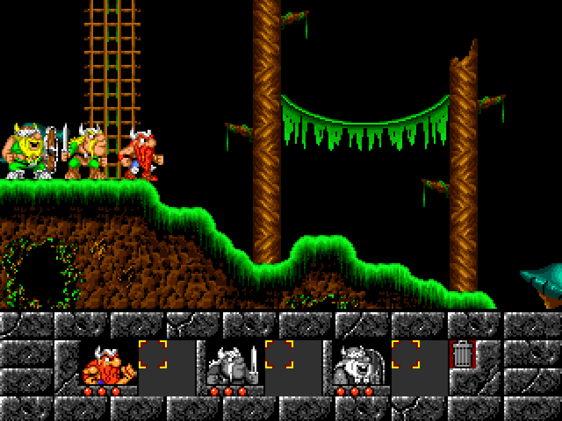
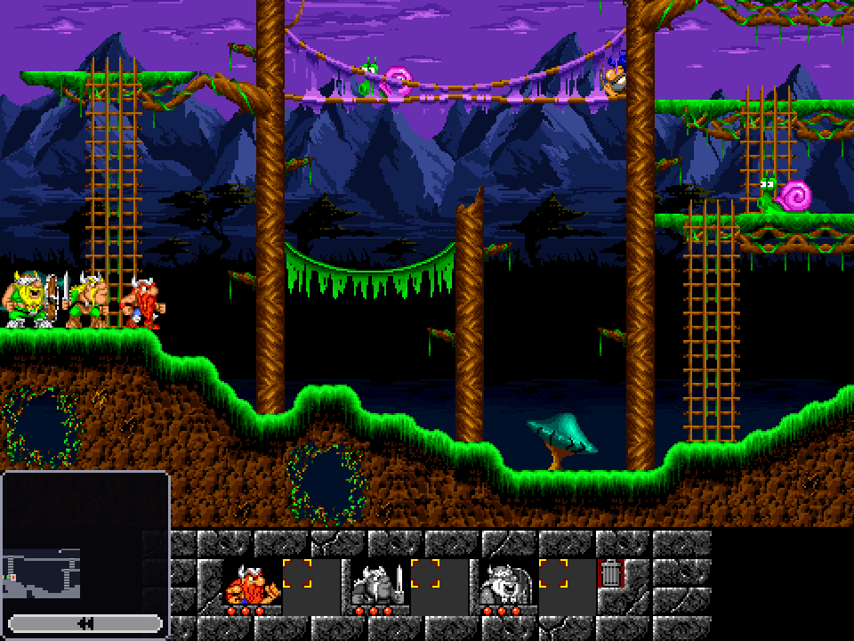
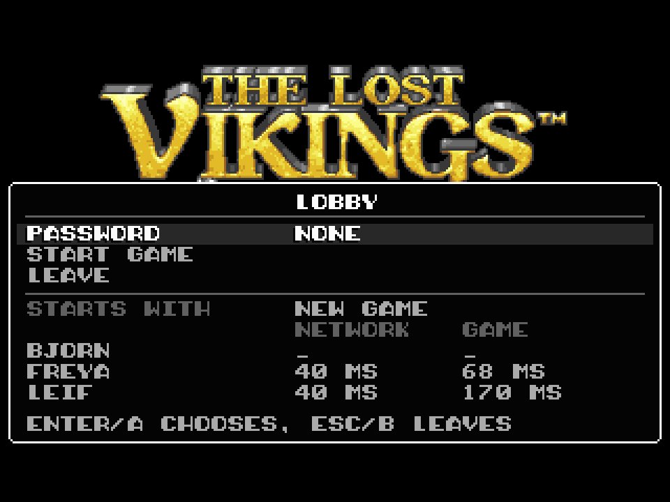
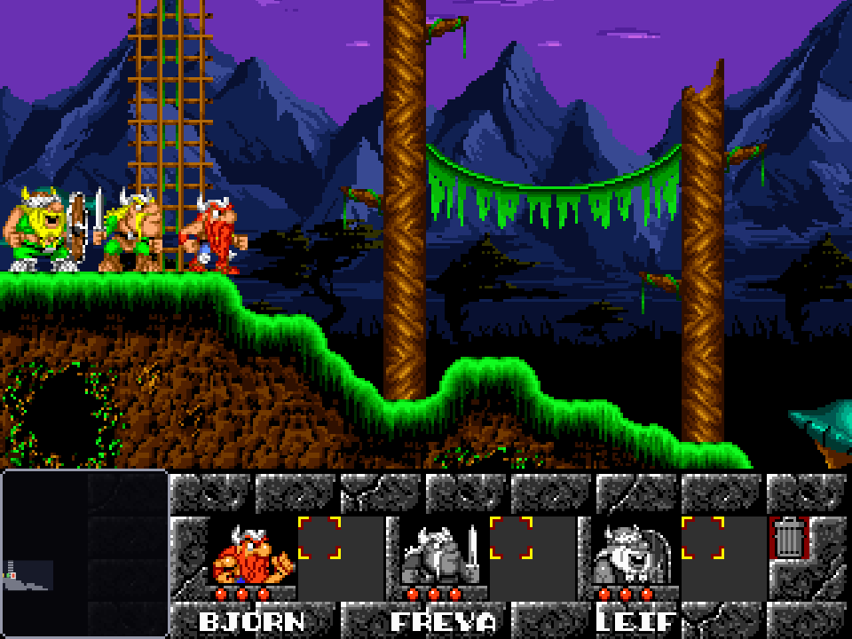
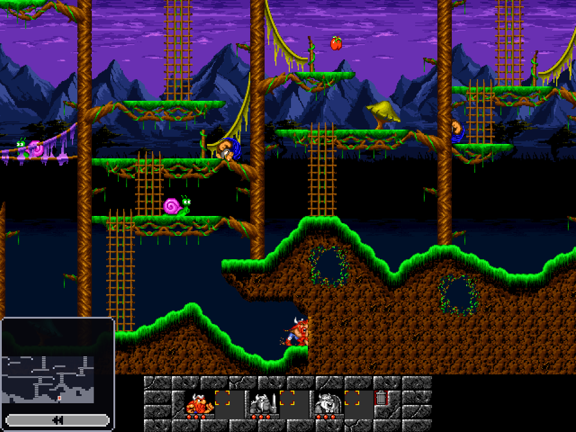
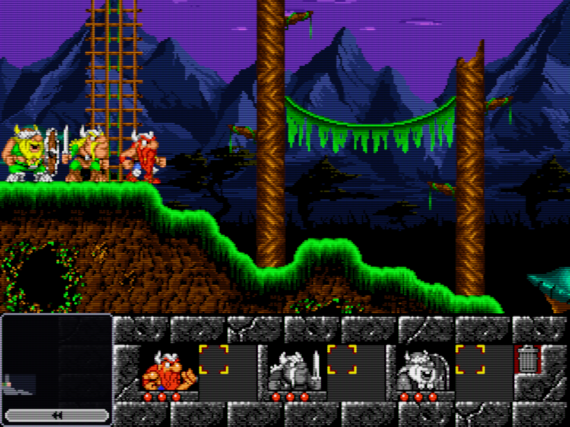
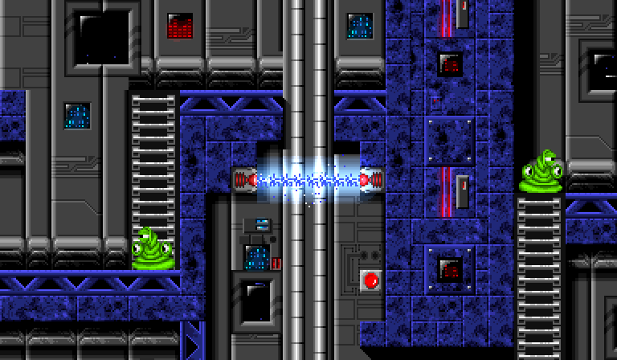
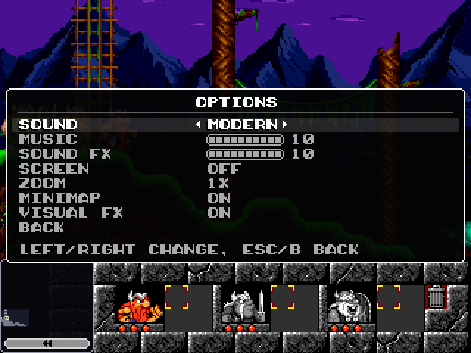
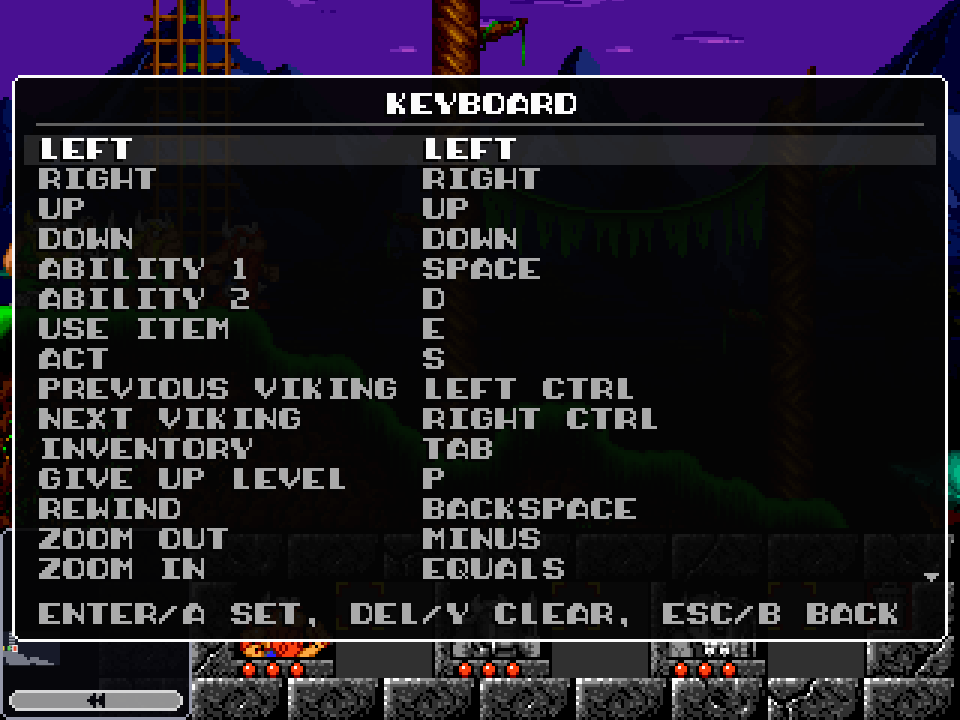

# The Lost Vikings Remastered

A remake of one of my favorite DOS games, The Lost Vikings (Silicon & Synapse, 1993): the whole game on an engine
written from transcriptions of the original's behavior, plus the quality-of-life and visual improvements I wanted.

The repo has no game data, art or text in it. You provide your own copy of the DOS game (and, optionally, the SNES
ROM), and the engine reads the files as they are.

<table>
  <tr>
    <th>Vanilla</th>
    <th>Remaster, zoomed out 1.5×</th>
  </tr>
  <tr>
    <td width="50%"></td>
    <td width="50%"></td>
  </tr>
</table>

## Two ways to play

**Vanilla** is the original, exactly: the same picture, sounds and quirks.

**Remaster** plays the same game and adds:

- **Co-op online** for up to three, one Viking each, with a lobby and rollback netcode
- **Zoom out** to 1.5× or 2× the original's view, and a **minimap** of what you've seen
- **Rewind** the last ten seconds, sound and all
- **Smooth movement**, **parallax** (the SNES backdrops, from your own ROM), and **light, glow and particles**
- **CRT** or **xBR** screen looks
- **Modern sound**: the game's General MIDI music through a SoundFont, effects placed by where they happen
- **A menu** for all of it, with **rebindable keys and gamepad buttons**, and analog walking on a stick

<table>
  <tr>
    <th>Co-op: the lobby</th>
    <th>Co-op: three players</th>
  </tr>
  <tr>
    <td width="50%"></td>
    <td width="50%"></td>
  </tr>
  <tr>
    <th>Zoomed out, with the minimap</th>
    <th>Rewinding</th>
  </tr>
  <tr>
    <td width="50%"></td>
    <td width="50%"></td>
  </tr>
  <tr>
    <th>CRT</th>
    <th>xBR</th>
  </tr>
  <tr>
    <td width="50%"></td>
    <td width="50%"></td>
  </tr>
  <tr>
    <th>Fire jets</th>
    <th>An electric barrier</th>
  </tr>
  <tr>
    <td width="50%"></td>
    <td width="50%"></td>
  </tr>
  <tr>
    <th>Options</th>
    <th>Controls</th>
  </tr>
  <tr>
    <td width="50%"></td>
    <td width="50%"></td>
  </tr>
</table>

## Playing it

Download the archive for your system from the [releases](https://github.com/sytsevg/the-lost-vikings-remastered/releases),
unpack it, put your own `DATA.DAT` and `VIKINGS.EXE` in `gamedata/original/`, and start `vikings-remaster`. Optionally
add the SNES ROM (`*.sfc`, US release) there too, for the backdrops. The SoundFont
([GeneralUser GS](https://www.schristiancollins.com/generaluser.php)) is included. Settings, the minimap and the
quicksave are kept in `profiles/` next to the program, and a log of each run in `logs/` (attach it to a bug report: it
holds no paths or addresses).

### Requirements

|             |                                                                          |
| ----------- | ------------------------------------------------------------------------ |
| **Linux**   | x86-64, glibc 2.38+, a **Wayland** session (no X11), a **Vulkan** driver |
| **Windows** | Windows 10+, x86-64, a **Vulkan** driver                                 |

On Linux the start-up box needs `zenity` or `kdialog`; without one, pass `--rules vanilla` or `--rules remaster`.

### Controls

Vanilla uses the original's keys: arrows, Ctrl to switch Viking, E, S, D and F, Tab for the inventory, Esc to pause,
F10 to quit. A gamepad works as the original's joystick. Remaster's defaults, all changeable in the menu:

|                        | Keyboard               | Gamepad               |
| ---------------------- | ---------------------- | --------------------- |
| Move, climb            | arrows                 | d-pad or left stick   |
| Abilities              | Space, D               | A, B                  |
| Use item, act          | E, S                   | X, Y                  |
| Previous / next Viking | Left Ctrl / Right Ctrl | LB / RB               |
| Inventory              | Tab                    | Back                  |
| Rewind (hold)          | Backspace              | left trigger          |
| Zoom out / in          | `-` / `=`, mouse wheel | right stick up / down |
| Minimap                | M                      | right stick press     |
| Menu                   | Escape                 | Start                 |

### Co-op online

Under Remaster rules, pick HOST GAME or JOIN GAME in the title's menu. Everyone needs the same release and game
files, and the host's port must be reachable (LAN, port forward, or a VPN such as Tailscale). The host starts the
game from the lobby and can bring everyone back to it; late joiners drop into the running game. Linux and Windows
play together.

Note: entities come alive wherever any player's view reaches, so a level can play a little differently than alone.

## How was it built?

Vanilla has to be pixel perfect: feed the remake and the original the same key presses, and every frame and every
sound request must match. It does, on recorded runs that cover every level.

First came the game's files: the archive, compression, graphics, levels and music, all decoded straight from the
original at start-up. Then the bytecode and its virtual machine, read from a disassembly of `VIKINGS.EXE` and written
down in plain words ([`docs/original/`](docs/original/)), with a patched DOSBox to drive the original for comparison.
An interpreter of that bytecode was built and checked against DOSBox until its memory matched the original's, byte
for byte. Then the engine was written by hand, one C++ class per kind of thing in the game, and compared against the
interpreter until every frame matched. The interpreter is gone; its recordings remain, and every change must match
them. Last came the remaster's improvements, on top of the original's behavior.

This game is a rewrite that happens to behave the same.

## Choices made along the way

### The engine

- **Clean room.** No decompiled code. The docs describe what the original does, with addresses as evidence; the
  code is written from the docs.
- **The original's clock.** VGA Mode X runs at 59.71 Hz; the game steps every third refresh, 19.9 times a second.
- **Integers only, no wall clock.** Same input, same result, every time: what the frame comparison and the netcode
  both rest on.
- **A class per kind of entity**, with an explicit state for each place the original's script waits. A kind lists
  what it looks for (walls, ground, a Viking); the engine tests after everything has moved, in that order.
- **State you can write down.** Each kind's memory is one plain struct, written field by field at fixed widths. The
  bytes are the same on every platform, and the quicksave, rewind, online checks and joining mid-game all use them.
- **Imported or written.** Graphics, levels, music, texts and animations are the original's; how the game plays is
  ours.
- **Two sounds of the five shipped.** Classic is OPL3 as the original's Sound Blaster Pro driver played it, faults
  included; Modern is the General MIDI version through a SoundFont, with some fixes.
- **Quirks stay, accidents go** ([`docs/quirks.md`](docs/quirks.md)).

### How it's tested

- **Recordings.** 119 runs cover every level and scene. Each has a golden, a hash of the picture, palette and sound
  requests at every refresh, recorded from the bytecode interpreter. A golden is never re-recorded to make a
  difference go away.
- **Saving and rollback for free.** In the same pass, before every step, the world is saved and reloaded, and play
  resumes from a snapshot 8 steps back (GGPO's sync test). About 90 seconds for all of them.
- **The original as referee.** `tools/lockstep.py` plays the same input into a scriptable DOSBox-X and the remake and
  compares the pictures.
- **The GPU renderer** must give the CPU one's exact picture at the original's size.
- **And the usual:** sanitizers, clang-tidy as errors, a fuzzer per file decoder, 80%+ line coverage from unit tests.

### The netcode

- **Rollback, as GGPO does it.** Every machine runs the whole game and only inputs travel (16 bytes per player per
  step). A late input is predicted as the last one; when it turns out different, the game rolls back to the step it
  got wrong and replays from there. An 8-step window, 0-2 steps of input delay from the round trip, and time sync.
- **Out-of-step detection.** Every 8th confirmed step is hashed and compared; a machine that drifts writes a log that
  `lv-replay --coop` replays offline.
- **UDP and TCP both, first wins.** Each packet carries every unacknowledged input and is numbered, so lost, late or
  doubled packets change nothing. Everything goes through the host: only it needs an open port, no relay server.
- **Never rolled back:** scene changes wait for confirmed inputs, and sounds play once however often a step reruns.
- **The game doesn't stop.** Only the host drives menus and scenes; hints show to and pause only the player concerned.
- **Joining mid-game** sends a ~26 KB snapshot and a step slightly ahead to arrive at, so nobody waits.
- **Tested without sockets:** the protocol runs on a toy game over a seeded simulated network with latency, loss and
  reordering.

### The picture

- **Two renderers.** Vanilla draws on the CPU, as the original. Remaster draws on the GPU (Vulkan), keeping each
  picture as a list of atlas rectangles drawn at the screen's refresh: movement is spread evenly a third of a tick
  behind, so it's smooth with no added input lag.
- **Remaster never touches Vanilla.** The rules are fixed at launch and all replays run under Vanilla.

More, with the reasoning, in [`docs/decisions.md`](docs/decisions.md); how the code fits together in
[`docs/architecture.md`](docs/architecture.md).

## Building it

It builds on Linux, for Linux and Windows, with Podman (the dev container has the toolchain) or your own Clang 23,
CMake and Ninja. Put the game's files in `gamedata/original/` and the SoundFont at `gamedata/GeneralUser-GS.sf2`.

```sh
./run-dev-env.sh build    # build/release/bin/vikings-remaster
./run-dev-env.sh test     # the same, then every check
make release              # the Linux and Windows archives, in build/dist/
```

Run it on your own desktop (the container has no screen or sound): `--rules remaster` skips the box, `--slot 0`
starts in level 1, and a second window with `--profile DIR` can join the first over 127.0.0.1. The rest is in
[`docs/development.md`](docs/development.md).

## Want to help?

Please do; bug reports are as welcome as code. The most useful is "this doesn't behave like the original": tell me
the level and what you did. If you change the engine, run `./run-dev-env.sh test` first: the recordings are my only
record of how the original behaves, so a replay that stops matching needs a reason.

One hard rule: nothing from the game goes into the repo (no data, art, dialogue or decompiled code; the screenshots
are the one exception). Describe what you find in your own words in `docs/original/` and write the code from that.
Where things stand: [`docs/HANDOVER.md`](docs/HANDOVER.md).

## Licence

The code is [MIT](LICENSE); the libraries it uses are listed in [`THIRD-PARTY-NOTICES.md`](THIRD-PARTY-NOTICES.md).
The Lost Vikings belongs to Blizzard Entertainment; this project isn't affiliated with or endorsed by them, and
doesn't include any of their game.

## A note on how this was made

Built with a lot of help from AI: Claude (Anthropic), through Claude Code. The reverse engineering, the engine and
these docs were written together with it.
