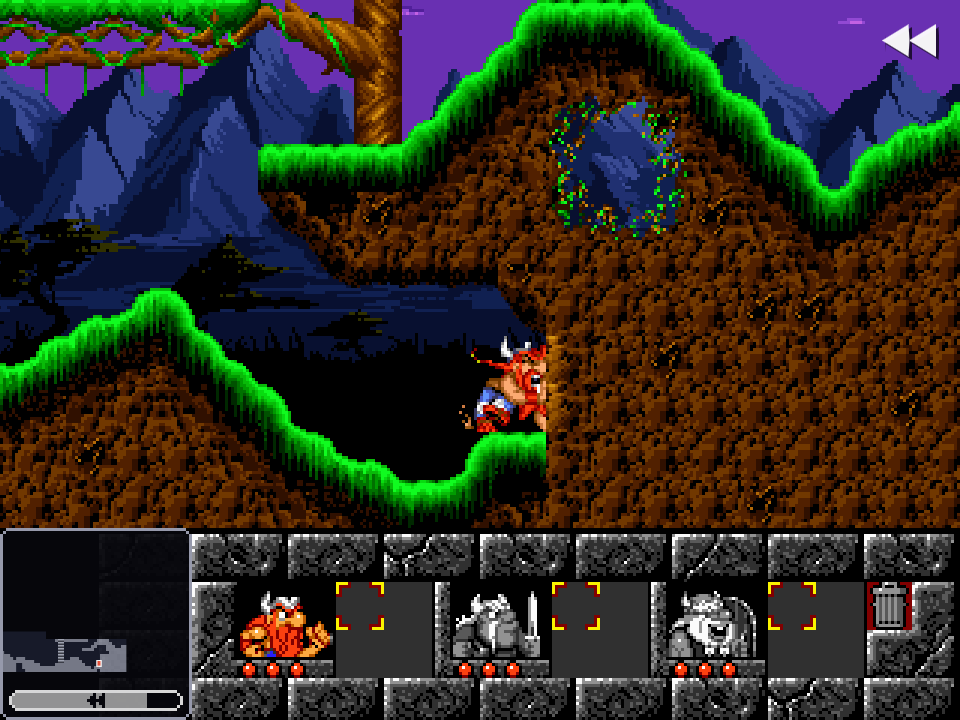
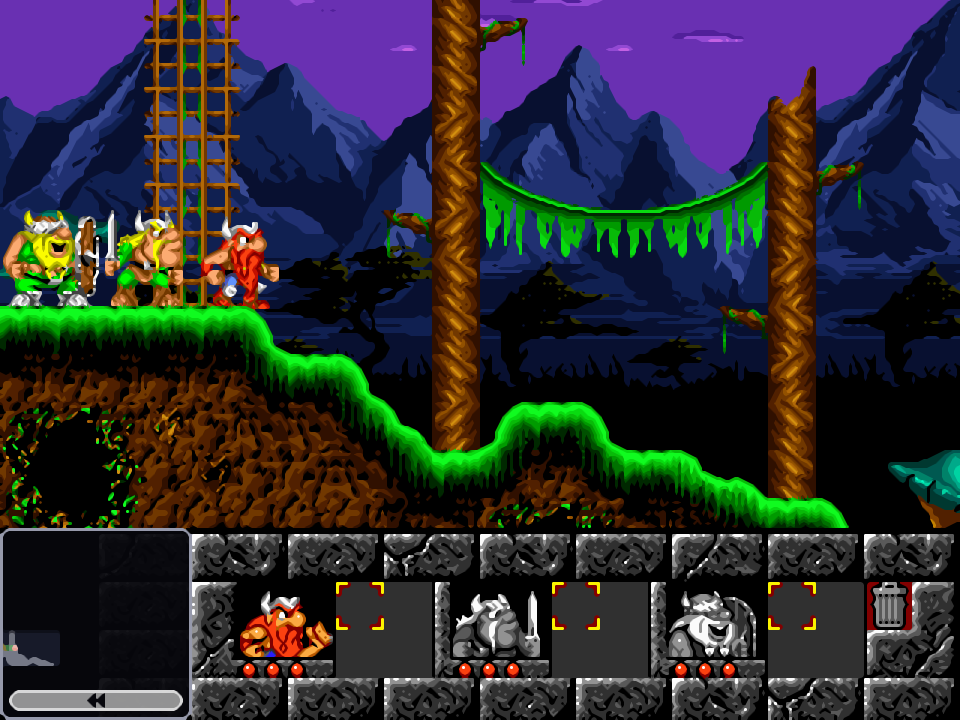
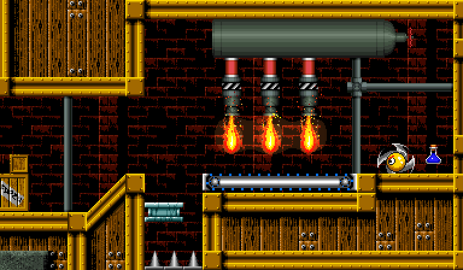

# The Lost Vikings Remastered

This started as a way to learn how to remaster one of my favorite DOS games. The game is The Lost Vikings (Silicon &
Synapse, 1993), the result is a remake with the whole game running on an engine written from transcriptions of the
original's behavior. The reason I wanted to remaster it was because of the quality-of-life improvements I wanted to
add, and visual changes to improve the experience.

The repo has no game data in it, no art and no text. You need to provide your own copy of the original DOS game
files (and, optionally, the SNES ROM) and the engine reads them as they are.

<table>
  <tr>
    <th>Vanilla</th>
    <th>Remaster, zoomed out 1.5×</th>
  </tr>
  <tr>
    <td width="50%"></td>
    <td width="50%"></td>
  </tr>
</table>

## Two ways to play

When it starts, it asks which rules to play by.

**Vanilla** is the original, exactly: the same picture, the same sounds, the same quirks, at the same 19.9 steps a
second. Keyboard or gamepad.

**Remaster** keeps the game as it plays and adds to it:

- **Co-op online** for up to three players, one Viking each, everyone on their own screen. Host or join from the
  title's menu, wait in the lobby, play, and go back to the lobby for the next level. It uses rollback, so the game
  stays responsive over a normal internet connection.
- **Zoom out** to one and a half or twice the original's view (`-` and `=`, the mouse wheel, or the right stick).
- **A minimap** of what you have seen of the level (M).
- **Rewind**: hold Backspace (or the left trigger) to take back the last ten seconds, sound and all, played backwards.
- **Smooth movement** between the original's steps, on the graphics card.
- **Parallax**: with your own SNES ROM beside the game's files, the SNES version's backdrops scroll behind the levels.
- **Light, glow and particles** from fire, electricity, laser shots, bombs and teleporters, in the game's own pixels.
- **A CRT look** (Hyllian's CRT shader) or **xBR** smoothing, if you like.
- **Modern sound**: the game's own General MIDI music through a SoundFont, with the effects placed left and right by
  where they happen. The original's OPL3 sound is there too.
- **A menu** (Escape, or Start on a gamepad) for the sound, the volumes, the screen, the zoom and the effects, and
  for the **controls**: every key and gamepad button can be changed.
- **Gamepads** of every kind SDL knows, with **analog walking**: push the stick a little and the Viking walks slowly.

### Co-op online

<table>
  <tr>
    <th>Co-op: the lobby</th>
    <th>Co-op: three players</th>
  </tr>
  <tr>
    <td width="50%"></td>
    <td width="50%"></td>
  </tr>
</table>

### Zoom, minimap and rewind

<table>
  <tr>
    <th>Zoomed out, with the minimap</th>
    <th>Rewinding</th>
  </tr>
  <tr>
    <td width="50%"></td>
    <td width="50%"></td>
  </tr>
</table>

### Screen looks

<table>
  <tr>
    <th>CRT</th>
    <th>xBR</th>
  </tr>
  <tr>
    <td width="50%"></td>
    <td width="50%"></td>
  </tr>
</table>

### Effects

<table>
  <tr>
    <th>Fire jets</th>
    <th>An electric barrier</th>
  </tr>
  <tr>
    <td width="50%"></td>
    <td width="50%"></td>
  </tr>
</table>

### The menu

<table>
  <tr>
    <th>Options</th>
    <th>Controls</th>
  </tr>
  <tr>
    <td width="50%"></td>
    <td width="50%"></td>
  </tr>
</table>

## Playing it

Download the archive for your system from the [releases](https://github.com/sytsevg/the-lost-vikings-remastered/releases)
and unpack it. Then put your own copy of the DOS game's `DATA.DAT` and `VIKINGS.EXE` in its `gamedata/original/`
folder and start `vikings-remaster` (`vikings-remaster.exe` on Windows). If the files aren't there, it says so.

Optional extras, in the same places:

- **The SNES ROM** (`*.sfc`, the US release) in `gamedata/original/`, for the backdrops behind the levels.
- **The SoundFont** for the Modern sound, `gamedata/GeneralUser-GS.sf2`. The release archives already have it
  ([GeneralUser GS](https://www.schristiancollins.com/generaluser.php) by S. Christian Collins).

The box that asks for the rules notes what Remaster would play without. The game keeps your settings, the minimap
and the quicksave in `profiles/` next to the program, and nowhere else.

### Requirements

|             |                                                                                              |
| ----------- | -------------------------------------------------------------------------------------------- |
| **Linux**   | x86-64, glibc 2.38 or later, a **Wayland** session (no X11) and a **Vulkan** driver          |
| **Windows** | Windows 10 or later, x86-64, and a **Vulkan** driver (the graphics card's own driver has it) |

Remaster rules draw with Vulkan on both. The box at the start needs `zenity` or `kdialog` on Linux; without one,
start it with `--rules vanilla` or `--rules remaster`.

### Controls

Vanilla rules use the original's keys: the arrows to move, Ctrl to switch Viking, E, S, D and F for what each of
them can do, Tab for the inventory, Esc to pause, F10 to quit. A gamepad works as the original's joystick.

Remaster's keys by default:

|                        | Keyboard               | Gamepad               |
| ---------------------- | ---------------------- | --------------------- |
| Move, climb            | arrows                 | d-pad or left stick   |
| Abilities              | Space, D               | A, B                  |
| Use item, act          | E, S                   | X, Y                  |
| Previous / next Viking | Left Ctrl / Right Ctrl | LB / RB               |
| Inventory              | Tab                    | Back                  |
| Rewind (hold)          | Backspace              | left trigger          |
| Zoom out / in          | `-` / `=`, mouse wheel | right stick up / down |
| Minimap                | M                      | right stick press     |
| Menu                   | Escape                 | Start                 |

All of them can be changed in the menu.

### Co-op online

One player hosts and the others join, each with a Viking of their own on a screen of their own. Everyone needs the
same release and the same game files, and the host's port must be reachable (a LAN, a forwarded port, or a VPN such
as Tailscale). Under Remaster rules the title's menu has HOST GAME (a name, a port, and a level's password, or none
for a new game) and JOIN GAME (a name, and the host's IP:PORT). Everyone waits in the lobby until the host starts the
game; the host can bring everyone back there from the game, to start another. Who comes later joins the game while
it goes on. Linux and Windows play together.

Note: the game may behave differently as the level entities animate based on view. The game animates entities as a
union of all player views.

## How was it built?

The game requirement for vanilla is pixel perfect. The test for it is strict: feed the remake and the original the same
key presses and compare every frame, pixel by pixel, along with every sound the game asks for. It matches on all of the
recorded runs, and those cover every level.

Getting there took a lot of iterations to first decode the original's behavior and then replicate it accurately.

First step was to read the game assets. The archive format, the compression, the graphics, the levels, the music.
All of it is decoded straight from the original when the game starts. Nothing gets converted or saved to disk.

Next came the bytecode the game uses and the virtual machine. This required disassembly of `VIKINGS.EXE`, writing
down rules and numbers in plain words (they're in [`docs/original/`](docs/original/)). For everything visual in a
running game a patched DOSBox can drive it for pixel comparison: press these keys, stop here, render the screen.

Then came the implementation of the game engine based off the bytecode and vm. It has a small interpreter and a few
hundred scripts in bytecode. The interpreter was built first and checked against DOSBox until its memory was
identical to the original's, byte for byte. The engine was then implemented by hand, one plain C++ class for each
kind of thing in the game, and compared against the interpreter until every frame was the same. Once that was
achieved, the interpreter could be discarded. What's left of it is a set of recordings that every change still has
to match.

Last came the remaster improvments and enhancements, which include updated graphics, improved audio, and quality-of-life
features while maintaining the original game's behavior.

This game is a rewrite that happens to behave the same.

## Choices made along the way

### The engine

**Clean room.** Never copied decompiled code. The docs describe what the original does, with addresses as evidence,
and the code is written from the docs.

**The original's odd clock.** VGA Mode X ran at 59.71 Hz, not 60. The game does one step of logic every three screen
refreshes, which makes 19.9 steps a second.

**Integers only, no wall clock.** Same input, same result, every time. That's what makes the frame-by-frame
comparison possible, and what lets co-op online run the same game on every machine with only the key presses sent.

**One plain class for each kind of thing.** The original runs a few hundred bytecode scripts. The remake has one C++
class per kind of entity instead, with an explicit state for every place the script used to wait. A kind doesn't
run its own collision tests: it hands the engine a list of what it is looking for (walls, ground, a Viking it
touches), the engine does the looking after everything has moved, and the kind reads the answers on its next turn.
The order of that list is behaviour, so it belongs to the kind.

**State you can write down.** Everything a kind remembers lives in one plain struct, and the engine writes that out
field by field, at a fixed width, low byte first, without naming a single field (reflection over the struct). A
saved world is the same bytes on Linux and Windows. The quicksave, rewind, the online checks and joining a game that
is already going are all built on that one rule.

**Imported or written.** Graphics, levels, music, texts and the animation programs are used as the original has
them, decoded at start-up. How the game plays is ours.

**Two kinds of sound, out of five.** The original shipped its music and effects five times over, for five sound
devices. The remake has two, "Classic" is the OPL3 FM version, played the way the original's Sound Blaster Pro driver
played it, including its habit of cutting into the music when too many effects go off at once. "Modern" is the
General MIDI version through a SoundFont, where there have been some fixes and adjustments.

**Quirks stay, accidents go.** Everything odd that was found is in [`docs/quirks.md`](docs/quirks.md), with a note on
whether it was kept.

### How it's tested

**Recordings, not opinions.** 119 recorded runs cover every level and scene. Each has a golden: a hash of the
picture, the palette and every sound request at every screen refresh, recorded from an interpreter of the
original's own bytecode that had itself been checked against the real game in DOSBox. The engine has to match every
refresh of every one of them. A golden is never recorded again to make a difference go away: there's nothing left
to record from, so a difference is a change of behaviour until shown otherwise.

**Every replay tests saving and rollback for free.** In the same pass, before every step, the world is written out
and read back, and the play goes on from a snapshot taken 8 steps back (GGPO's "sync test"). If any piece of state
is missing from a save or a copy, a replay stops matching. All 119 take about a minute and a half.

**The original is the referee.** A patched DOSBox-X with a small control channel can be driven by a script: press
these keys, stop at this step, take a screenshot. `tools/lockstep.py` plays the same input into the original and the
remake and compares the pictures, whenever something new comes up or something is in doubt.

**The GPU renderer has to agree.** Drawn at the original's size, it must give the exact same picture as the CPU one,
checked against the same goldens.

**And the usual,** strictly: unit tests under AddressSanitizer and UndefinedBehaviorSanitizer, clang-tidy with
warnings as errors, a fuzzer for every decoder of the game's files, and at least 80% of the lines covered by the unit
tests alone.

### The netcode

**Rollback, as GGPO does it.** Every machine runs the whole game; only the players' input travels, 16 bytes per
player per step (the keys, the stick's pace, the zoom). When a player's input hasn't arrived yet, the game assumes
they're still doing what they did last (holding a direction is the common case) and carries on. When the real input
turns out different, it goes back to the first step it got wrong and runs the steps again from there, unseen. A
window of 8 steps, 0 to 2 steps of input delay picked from the round trip, and a machine that runs ahead waits a
refresh now and then to keep everyone together.

**Determinism makes it work.** Integers only and no clock means machines fed the same inputs compute the same game,
a Linux and a Windows machine too. Every 8th confirmed step is hashed and the hashes compared; should a machine
drift, each writes a log of its inputs, which `lv-replay --coop` plays offline to find the first step that differs.

**UDP and TCP both, first one wins.** The game's messages go out over both, the same bytes. Each packet carries
every input the other side hasn't acknowledged yet, and they're numbered so only a newer one is taken: a lost, late
or doubled UDP packet changes nothing, and TCP is there behind it when UDP doesn't get through. Everything goes
through the host, so only the host needs a reachable port, and there's no relay server.

**Some things are never rolled back.** A step that changes the scene (a level ending, a fade, a level loading) only
runs once everyone's input for it is in. Sounds are keyed by their step and entity, so a step that runs again
doesn't play them twice.

**Co-op that doesn't stop the game.** Only the host drives the menus, the passwords and the scenes. Hints and
conversations show only to the player whose Viking started them, and only that Viking waits while everyone else
plays on. Each player has their own inventory, and items pass between Vikings standing within reach.

**Joining a game already going.** A player who joins gets a snapshot of the world (about 26 KB in level 1) and a
step a little in the future to arrive at, so nobody waits while they load and catch up.

**The protocol never sees a socket in its tests.** It knows the game only through a small interface, and the network
only through another. Its tests play it on a toy game over a simulated network with latency, jitter, loss and
reordering, seeded so a failure can be repeated.

### The picture

**Two renderers.** Vanilla draws on the CPU into 320×240 palette indices, exactly as the original would. Remaster
draws on the GPU (Vulkan), keeping each picture as a list of rectangles from an atlas and drawing it at the moment
the screen refreshes. That's what makes the movement smooth: the original moves in uneven whole-pixel steps three
times a tick, and the remake spreads that out evenly, a third of a tick behind, so it adds no input lag and never
guesses at the future.

**Remaster never touches Vanilla.** The rules are chosen at launch and never change while playing, and all 119
replays run under Vanilla rules, so anything Remaster adds that leaks into Vanilla shows up at once.

There's more of this, with the reasoning, in [`docs/decisions.md`](docs/decisions.md). If you'd rather see how
the code is put together, start with [`docs/architecture.md`](docs/architecture.md).

## Building it

It builds on Linux, for Linux and Windows. You need Podman, or your own Clang 23 with CMake and Ninja.

Put the DOS release's `DATA.DAT` and `VIKINGS.EXE` in `gamedata/original/`, and for the Modern sound the GeneralUser
GS SoundFont at `gamedata/GeneralUser-GS.sf2`. The game finds `gamedata/` beside its program, or else in the folder
it is started in (the repository's, for a build), and keeps what it writes beside its program: `profiles/` and
`logs/`.

The easy way uses the dev container, which has the whole toolchain in it:

```sh
./run-dev-env.sh build    # gives you build/release/bin/vikings-remaster
./run-dev-env.sh test     # the same, then runs every check
make release              # the Linux and Windows release archives, in build/dist/
```

Or directly:

```sh
cmake --preset release
cmake --build --preset release
```

Then run it on your own desktop, since the container has no screen or sound:

```sh
./build/release/bin/vikings-remaster                  # from the first logo; a box asks which rules
./build/release/bin/vikings-remaster --slot 0         # straight into level 1
./build/release/bin/vikings-remaster --rules remaster # the Remaster rules, without the box
```

To try co-op on one machine, a second window with a profile of its own:

```sh
./build/release/bin/vikings-remaster --rules remaster   # then HOST GAME in the title's menu
./build/release/bin/vikings-remaster --rules remaster --profile build/release/bin/profiles-guest   # JOIN GAME, 127.0.0.1
```

Everything else about building, the checks, the releases and the code style is in
[`docs/development.md`](docs/development.md).

## Want to help?

Please do. Bug reports are as welcome as code.

The most useful kind of report is "this doesn't behave like the original". Tell me the level and what you did.

If you change the engine, run `./run-dev-env.sh test` first (or `./scripts/check.sh` and `./scripts/goldens.sh`
by hand). The recordings are my only record of how the original behaves, so if one stops matching, the game has
changed, and that needs a reason.

One hard rule: nothing from the game itself goes into the repo. No data, no art, no dialogue, no decompiled
code (the screenshots above are the one exception). If you figure out something about the original, describe it in
your own words in `docs/original/` and write the code from that.

[`docs/HANDOVER.md`](docs/HANDOVER.md) says where things stand and how I work on it.

## Licence

The code is [MIT](LICENSE). The libraries it uses have their own licences, listed in
[`THIRD-PARTY-NOTICES.md`](THIRD-PARTY-NOTICES.md).

The Lost Vikings belongs to Blizzard Entertainment. This project isn't affiliated with or endorsed by them, and
it doesn't include any of their game.

## A note on how this was made

This project was built with a lot of help from AI, specifically Claude (Anthropic), through Claude Code. The
reverse engineering, the engine and these docs were written together with it.
